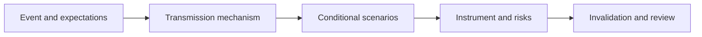

# Macro Research Pipeline

**English** · [简体中文](README.zh-CN.md)

A headline arrives in seconds. Understanding what it changes takes a few more questions.



A Codex Skill for turning macro events and financial news into sourced research records, conditional scenarios, trade expressions, and invalidation criteria.

## Follow the transmission

1. Establish the event, publication time, and prior expectations.
2. Identify the variables relevant to the target assets.
3. Explain the transmission mechanism, conditions, and alternative causes.
4. Find comparable historical episodes with sources.
5. Build conditional scenarios around observable indicators.
6. Connect each idea to an instrument, cost, and risk.
7. Define thesis invalidation, price exit, time expiry, and review triggers.

Use it for a single event, daily research, a personal macro framework, or a review using only information available at the original decision time.

## Install and try

```bash
mkdir -p ~/.codex/skills
git clone https://github.com/Bill306/macro-research-pipeline.git ~/.codex/skills/macro-research-pipeline
```

Start a new Codex chat to load the Skill.

```text
Use $macro-research-pipeline to study the latest Federal Reserve rate
decision and its conditional effects on US bonds and equities over
one to three months. Verify the sources and produce a research record.
```

Current data and historical claims require a search-capable agent. Missing evidence is explicitly recorded. Output appears in the conversation; when file saving is requested without a directory, records use `macro-research-notes/` in the working directory.

## Inside

[SKILL.md](SKILL.md) defines execution and completion checks. [The record template](references/research-record.md) supports follow-up review, and [agent metadata](agents/openai.yaml) provides the display name and invocation prompt.

Key facts carry direct sources. Historical analogies state dates, comparison windows, and limits. Position calculations require capital, a risk budget, and instrument parameters. Research ideas remain conditional on their stated evidence.
